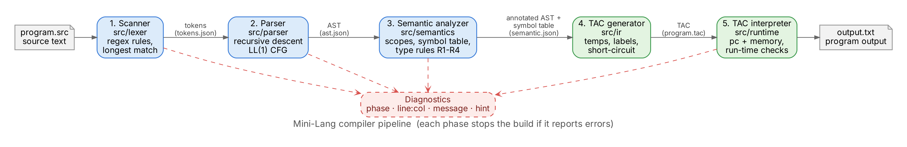

# Mini-Lang Compiler

This is a complete compiler for **Mini-Lang**, a small imperative language with `int` and `bool` variables, arithmetic, relational and logical expressions, `if`/`else`, `while` and `print`. The pipeline has five phases:

```
program.src → scanner → parser → semantic analyzer → TAC generator → TAC interpreter → output
```

The target is **Three-Address Code (TAC)**, which a small virtual machine in this repository executes. The compiler is written in Python 3 with the standard library only, so there is nothing to build or install.

**Status (v1.0):** 16/16 end-to-end tests and 38/38 unit tests pass. The end-to-end suite includes 6 negative tests: lexical, syntax, two semantic, duplicate-declaration and run-time. The grammar is verified to be LL(1).



---

## 1. Quick start

```bash
# Requirements: Python 3.9 or newer. No packages to install.
git clone <repository-url> && cd mini-lang-compiler

# Compile and run, as two separate steps
python scripts/compile.py examples/pdf_example.src -o build/out.tac
python scripts/run.py build/out.tac                    # prints 6

# Whole pipeline, writing every intermediate artifact to build/demo/
python scripts/minilangc.py examples/pdf_example.src -o build/demo

# Tests
python scripts/run_tests.py                            # end-to-end (golden) tests
python -m unittest discover -s tests/unit -v           # unit tests
make test                                              # both (if make is available)
```

On Linux and macOS, `scripts/compile.sh` and `scripts/run.sh` wrap the same commands.

## 2. Command-line interface

| Command | What it does |
|---|---|
| `compile input.src -o out.tac [--artifacts DIR]` | Runs phases 1–4 and writes TAC. With `--artifacts`, it also writes `tokens.json`, `ast.json`, `ast.txt`, `semantic.json` and `cfg.txt`. |
| `run out.tac [-o output.txt] [--max-steps N]` | Executes a `.tac` file with the TAC interpreter. |
| `minilangc input.src [-o build/] [--no-run]` | Runs all five phases, prints a phase-by-phase summary and writes every artifact. |
| `run_tests.py [-v] [--update] [--markdown FILE]` | Runs the golden test suite and prints a pass/fail matrix. |
| `ll1_check.py docs/grammar.txt [--table]` | Prints the FIRST and FOLLOW sets and the predictive table, and checks the grammar is LL(1). |

Each command lives in `scripts/` and is run as `python scripts/<name>.py`. Exit codes are `0` for success and `1` for compile or run-time errors.

### Artifacts per phase

| Phase | Input | Artifact | Content |
|---|---|---|---|
| Source | — | `*.src` | Mini-Lang program |
| 1. Lexical analysis | source text | `tokens.json` | Tokens: kind, lexeme, line, column |
| 2. Syntax analysis | tokens | `ast.json`, `ast.txt` | AST as JSON and as a drawn tree |
| 3. Semantic analysis | AST | `semantic.json` | Symbol table, type-annotated AST, errors, warnings |
| 4. Code generation | annotated AST | `program.tac`, `cfg.txt` | TAC, plus its basic blocks and control-flow graph |
| 5. Execution | TAC | `output.txt` | Program output, or the run-time error |

## 3. Project layout

```
src/
  common/diagnostics.py    Diagnostic type shared by every phase
  lexer/scanner.py         Phase 1: regex scanner → Token list
  parser/parser.py         Phase 2: recursive-descent LL(1) parser → AST
  parser/ast_nodes.py      AST node contract (fields of every node kind)
  parser/ast_printer.py    Tree rendering of the AST (ast.txt)
  semantics/analyzer.py    Phase 3: scopes, symbol table, type checking
  ir/tac_generator.py      Phase 4: annotated AST → TAC
  ir/basic_blocks.py       TAC → basic blocks and CFG (cfg.txt)
  runtime/tac_vm.py        Phase 5: TAC interpreter
  driver/pipeline.py       Chains the phases (fail fast)
  driver/cli.py            compile / run / minilangc front ends
scripts/                   CLI wrappers, test runner, LL(1) checker, ci.yml
tests/programs/            16 test programs (*.src)
tests/expected/            Expected TAC (*.tac) and expected output or diagnostics (*.out)
tests/unit/                38 unit tests, one class per phase
docs/                      language-spec.md, grammar.txt, design diagram (.dot/.svg/.png)
docs/report/               Final report (report.tex → report.pdf; build with xelatex)
examples/                  Small programs used in this README and in the demo
.github/workflows/ci.yml   Continuous integration (unit + golden + LL(1) check)
```

## 4. Module overview and interfaces

Each phase is a pure function with a narrow contract. Phases exchange plain data, so every intermediate result can be dumped to JSON and tested on its own.

| Module | Entry point | Input → output |
|---|---|---|
| Scanner | `scan(text)` | `str` → `(list[Token], list[Diagnostic])` |
| Parser | `parse(tokens)` | `list[Token]` → `(AST dict, list[Diagnostic])` |
| Semantic analyzer | `analyze(ast)` | AST → `{status, summary, symbol_table, errors, warnings, annotated_ast}` |
| TAC generator | `generate(annotated_ast)` | annotated AST → `list[str]` (TAC lines) |
| Interpreter | `TACMachine().run(text)` | TAC text → `list[str]` (output lines) |

The data passed between phases has these shapes:

- **Token:** `{kind, lexeme, line, column}`. The full set of kinds is in `docs/language-spec.md §2`.
- **AST node:** a dict with `node`, `line`, `column` and the fields for its kind. The fields are listed in `src/parser/ast_nodes.py`.
- **Diagnostic:** `{phase, message, line, column, category?, hint?}`. The same type is used by every phase.

Three invariants keep the modules compatible:

1. Phase *n + 1* runs only if phase *n* reported no errors.
2. After a successful semantic pass, every expression node has a `type` and every variable reference has a `storage` name. Code generation relies on both and does no checking of its own.
3. Every jump the generator emits targets a label it also emits. The interpreter rejects programs with undefined labels before execution starts.

## 5. TAC instruction set

| Instruction | Meaning |
|---|---|
| `x := y` | copy |
| `x := op y` | unary operation; `op` ∈ `-` (negate), `!` (not) |
| `x := y op z` | binary operation; `op` ∈ `+ - * / % < <= > >= == !=` |
| `goto L` | unconditional jump |
| `if y goto L` | jump if `y` is true |
| `if y relop z goto L` | jump if the comparison is true; `relop` ∈ `< <= > >= == !=` |
| `ifFalse y goto L` / `ifFalse y relop z goto L` | jump if false |
| `print y` | append the value of `y` to the output |
| `L:` | label (a jump target; it may share a line with an instruction) |

Operands can be:

- variables (`x`, or `x_1` for a shadowed variable)
- temporaries `t1, t2, …`
- integer literals
- `true` and `false`

`&&` and `||` have no TAC instruction: they compile into jumps (short-circuit evaluation). Integer `/` and `%` truncate toward zero, as in C. Lines starting with `#` are comments.

## 6. Worked examples

These outputs were produced by the compiler and the interpreter. The leading `x := 0` lines are the default initialization of each declared variable.

**1. Assignment** (`examples/assignment.src`)

```c
int a; int x;
a = 4;
x = a + 3;
print(x);
```

```
    a := 0
    x := 0
    a := 4
    t1 := a + 3
    x := t1
    print x
```

Output: `7`

**2. Conditional** (`examples/conditional.src`). This is the example from the project statement. The comparison is folded into the jump.

```c
if (x < y) { z = 1; } else { z = 0; }
```

```
    if x < y goto L1
    z := 0
    goto L2
L1:
    z := 1
L2:
```

**3. Loop** (`examples/pdf_example.src`)

```c
x = 1; sum = 0;
while (x <= 3) { sum = sum + x; x = x + 1; }
ok = sum == 6;
if (ok) { print(sum); } else { print(0); }
```

```
L1:
    ifFalse x <= 3 goto L2
    t1 := sum + x
    sum := t1
    t2 := x + 1
    x := t2
    goto L1
L2:
    t3 := sum == 6
    ok := t3
    if ok goto L3
    print 0
    goto L4
L3:
    print sum
L4:
```

Output: `6`. The corresponding basic blocks are in `build/demo/cfg.txt`.

## 7. Error handling

Every diagnostic shows the file, `line:column`, the phase, a message, the source line with a caret under the column and, when it helps, a hint:

```
s02_type_error.src:7:8: semantic error: while condition must be bool, but it is int
    while (n) {         // error: condition must be bool
           ^
    hint: use a comparison, e.g. (x != 0)
```

| Phase | Detected errors | Strategy |
|---|---|---|
| Lexical | invalid characters (with hints for `&` and `\|`), malformed numbers (`9lives`), unterminated `/*` | report all, then stop |
| Syntax | unexpected or missing tokens (`expected ';' after 'y'`) | panic-mode recovery, so all errors are reported, then stop |
| Semantic | undeclared variables, duplicate declarations, type mismatches, non-bool conditions | report all, then stop. Errors do not cascade: an undeclared operand does not also produce a type error. |
| Run time | division by zero, read of an unset variable, step limit exceeded (infinite loop) | stop. Output printed so far is kept. |

Some situations produce **warnings** instead of errors, and compilation continues:

- a variable that is never used
- a variable used before it is assigned
- a declaration that shadows an outer variable
- division by the constant 0

## 8. Limitations

Floats, functions, arrays, strings, input and multiple source files are not supported, and the compiler does not optimize the TAC. There are no declaration initializers (`int x = 1;`), and integers are unbounded (Python `int`). Section 7 of the language spec lists the extensions that would be next.

## 9. Mapping to the course rubric (ABET SO1)

- **Identify:** the scope, non-goals and risks are stated explicitly (§8 above and `docs/language-spec.md`).
- **Formulate:** the solution rests on formal foundations. The scanner uses regular expressions, the grammar is a verified LL(1) context-free grammar, the type rules are stated formally, and the TAC instruction set is documented.
- **Evaluate:** 54 automated checks, including negative tests, each compared against reviewed expected files.
- **Apply resources:** CLI tooling, a golden-test harness, a Makefile, GitHub Actions CI and graphviz diagrams.
